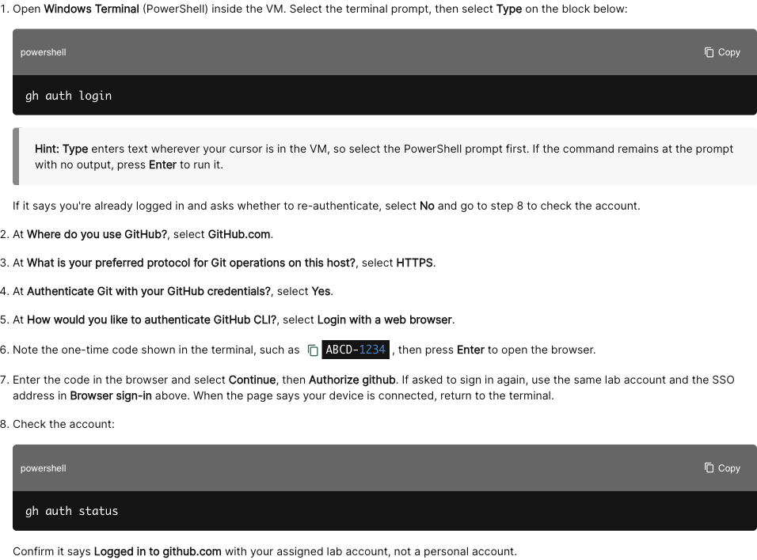
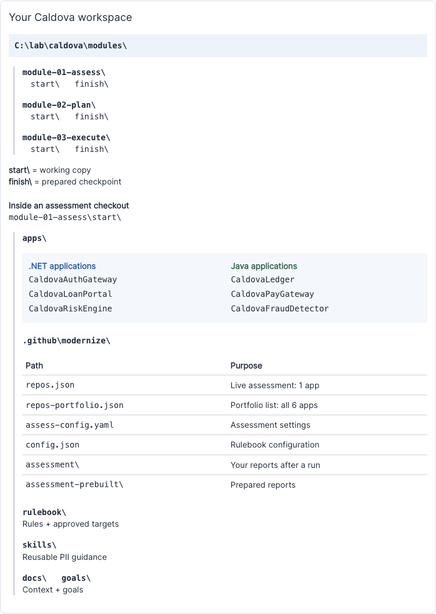

# Published lab guide backup

`prel38-skillable-guide.md` is a byte-for-byte copy of the full lab guide as published in Skillable instruction set **359549** on November 2, 2026 (118,251 bytes; SHA-256 `0a81aa3f6ba39360bccaf403ac84a3b1889680687cdbffddfeb8fb717eb4f93b`). Skillable remains the source of truth; this copy exists so the Part 2 corrections can be reapplied if the live guide is lost or overwritten.

It uses Skillable markdown: uploaded images are referenced as `!IMAGE [alt](instructions<set-id>/<file>.png)` and resolve only inside Skillable. `images/` holds five previously uploaded Part 2 screenshots, standalone diagram files, and two screenshots of the published revision below. The other guide screenshots were uploaded earlier, some by other authors, and live only in Skillable.

## Reapply the guide

Other authors edit other parts of the same guide, so don't paste this file over the live copy without comparing first.

1. From a running development lab, open **Settings > Edit Instructions**. The lab-client route is `https://labclient.labondemand.com/Instructions/Edit?Id=<running instance id>`; opening the redirected Studio editor URL directly can give Access Denied.
2. Copy the live guide out and diff it against this file. Keep newer edits from other authors; apply only the Part 2 corrections you need.
3. Upload any missing screenshots from `images/`, save, reload, and confirm the saved text matches what you intended.
4. Launch another fresh instance and check that the guide, screenshots, and **Resources > GitHub sign-in** entry appear.

## Resources tab entry

**Resources > GitHub sign-in** isn't part of the guide markdown; it's defined on the development lab profile under **Edit > Resources**. Recreate it with these values if it's missing:

- **Name:** `GitHub sign-in`
- **Type:** External Link
- **URL:** `https://github.com/enterprises/skillable-events/sso`
- **Display:** In resources list, opened in separate window
- **Description:**

  ```text
  Use this address in Microsoft Edge inside the VM. For numbered browser and CLI steps, open Instructions > Part 2 > Get ready > Sign in to GitHub. Use your lab account from Resources > Azure Portal.
  ```

### Step-by-step sign-in: published

**Part 2 > Get ready > Sign in to GitHub** now contains four browser steps and eight CLI steps, including each terminal choice and the final account check. The Resources entry is a short pointer to these instructions and retains its original SSO URL.

External-link resource descriptions render as plain text with `white-space: normal`, so numbered formatting belongs in the guide rather than that field. This published approach needs no separate document upload. [github-sign-in.html](github-sign-in.html) remains available as a standalone reference, not a required Skillable resource.



## Repository overview graphic: published

`repository-overview.md` is the published insertion in **Part 2 > Get ready**, immediately before **Sign in to GitHub**. It maps the learner workspace under `C:\lab\caldova\modules`, not this workshop-authoring repository.

The live graphic uses native HTML inside the guide. It adapts to the available width, retains selectable text, and does not depend on an uploaded image. The standalone SVG and PNG in `images/prel38-caldova-repo-structure.*` remain useful export versions, but are not dependencies of the live guide.

The map shows the three main module pairs, all six applications, Modernize configuration and report folders, and the rulebook and skills. Its paths follow **Prepared folders and assessment inputs**, **What to notice in the estate**, and the saved VM inventory. It deliberately omits optional deployment folders.



Only the **Get ready** page changed in this revision; all other guide content was preserved. The saved source hash and the map, four/eight numbered steps, and shortened resource description were checked after fresh server reads and a learner-view reload. These are guide/profile changes on development lab **224911**; no VM capture or production-profile change was made.
