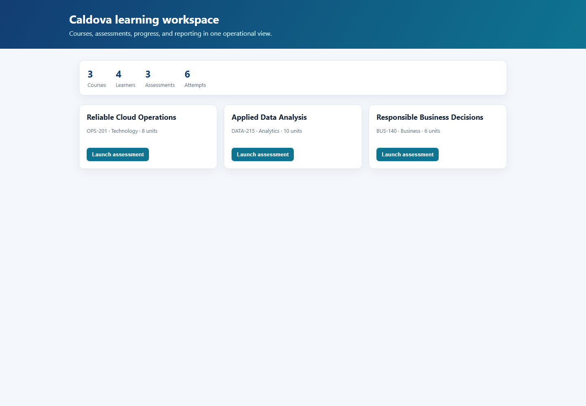

# Caldova attendee lab

Choose **exactly one** path and **exactly one** scenario for this lab. The 50-minute module does not allow time to complete every scenario.

| Path | Time | Choose this when |
|---|---:|---|
| [Preconfigured Agent](preconfigured-path.md) | 25–30 minutes | You want to inspect the complete reference configuration, reports, tasks, and retained incident evidence. |
| [Configure Agent](configure-path.md) | 50 minutes | You want the complete manual learning flow: investigate, draft a skill, create an alert/custom agent/response plan, and prove automatic handling. |

For Configure, keep the default **Course recommendations are unavailable** scenario. It produces immediate evidence before an alert exists and supports the full manual alert → skill → custom agent → incident response plan exercise. The other packaged scenarios are optional four-hour-path or post-lab exploration.

Stop after the path and scenario you select. Your facilitator will provide a learner number. The workstation is prepared before attendee use and does not download packages during the lab.

The prepared Caldova workload presents healthy course and assessment activity plus one intentionally degraded, non-blocking course-recommendations feature:

Before starting either path, read [Simulator and reset](simulator-and-reset.md) and [Screenshot inventory](screenshot-inventory.md).

## Measured alert timing

| Stage | Typical time |
|---|---:|
| Azure Monitor evaluation interval | 5 minutes |
| Symptom to alert | 5–10 minutes |
| Alert to incident thread | about 1–2 minutes |
| Investigation and permitted mitigation | 3–10 minutes |
| Healthy recovery to monitor resolution | 5–20 minutes |

While alert propagation is pending, continue the configuration or evidence-review steps. Return to the incident when it appears; do not refresh repeatedly or start another scenario.

> **Knowledge check (optional):** Why should an alert describe the user-visible symptom rather than an assumed cause?
