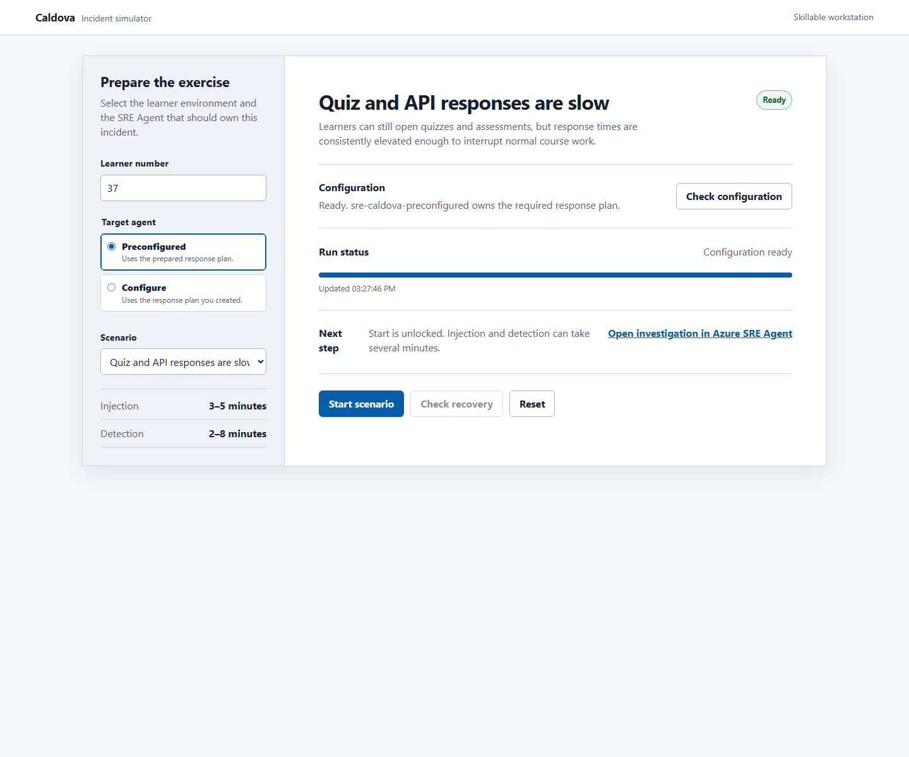

# Simulator and reset

Use the local packaged simulator; GitHub is not required.

## Start and select

```powershell
pwsh -NoProfile -File scripts/start-simulator.ps1 -LearnerNumber N
```

The wrapper starts an attached local process, verifies the page and status endpoint over HTTP, and opens or prints:

```text
http://127.0.0.1:7070/?learnerNumber=N
```

Keep its terminal open. Press Ctrl+C to stop it cleanly.

In the page:

1. Confirm the learner number.
2. Select the agent for the path you chose: **Preconfigured** or **Configure**.
3. Select exactly one scenario. Scenario names describe symptoms only.
4. Select **Check configuration**. Start remains disabled until readiness succeeds for that learner, agent, and scenario.

When the check passes, the simulator shows **Ready**, the selected symptom, timing estimates, and an enabled **Start scenario** action:



## Timing and progress

- Injection normally takes **3–7 minutes**, depending on the selected scenario.
- Azure Monitor evaluates the exercise alerts every **1 minute**; telemetry ingestion means detection can take **1–8 minutes**.
- Start is asynchronous. The progress region shows the current phase and the Cancel button remains available during a running operation.
- Do not refresh repeatedly, start a second scenario, or close the terminal while an operation is running.
- When available, **Open investigation in Azure SRE Agent** opens the selected agent’s live investigation.

If you cancel, the simulator reports **Cancelled**. Run Reset before attempting another operation.

## Recovery and reset

1. Let the selected agent investigate and apply or recommend the smallest reversible recovery action.
2. Select **Check recovery** only after the agent reports that the original symptom is healthy.
3. Recovery is complete only when the simulator reports **Recovery verified**.
4. Select **Reset**, review the confirmation, then select **Reset learner environment**.
5. Wait for **Baseline restored**. Reset restores the healthy workload and starting response-plan ownership, clears simulator state, and reruns readiness.

Do not run a second live scenario in the same lab attempt. If reset fails, stop and use the actionable error with the facilitator before another learner uses the environment.
